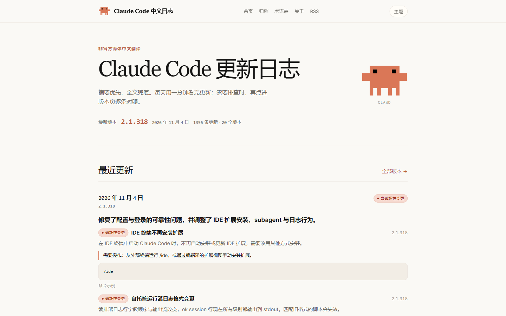

# Claude Code 中文更新日志

把 [Claude Code 官方 changelog](https://code.claude.com/docs/en/changelog) 变成可读、可查、可对照的中文站。

**在线站点**：https://frankarin.github.io/claude-code-changelog-zh/  
**归档**：https://frankarin.github.io/claude-code-changelog-zh/archive/  
**RSS**：https://frankarin.github.io/claude-code-changelog-zh/rss.xml

[](https://frankarin.github.io/claude-code-changelog-zh/)
[](LICENSE)
[](https://www.python.org/)



## 这是什么

Claude Code 几乎每个工作日都在发版，但官方更新日志只有英文原文。

官方中文文档覆盖了大部分功能文档，changelog 却仍然直接跳到 GitHub 上的英文 `CHANGELOG.md`；中文「最新动态」是每周摘要，目前停在 9 月中旬。英文 changelog 本身有 436 个版本、8,668 条条目，长版本还会把 improvements 和 bug fixes 折叠，想确认「我的问题修没修」只能逐条翻。

本站把这份 changelog 整理成一个中文站点：

- 首页按天聚合摘要，1 分钟看完近期更新；
- 每个版本保留逐条中文全文，需要排查时能定位到具体一条；
- 版本页支持中文 / English / 对照；
- 搜索覆盖中文、英文、版本号、日期。

非官方社区项目，不隶属 Anthropic，也未获其背书。英文原文为准。

## 特性

不是把几个功能堆在一起，而是让“看更新”和“查更新”共用一套数据。

### 一体化阅读

- **摘要入口**：TLDR、3–6 条关键变更、需要行动项、破坏性变更标记、命令示例。
- **逐条全文**：保留官方分组（Added / Changed / Improvements / Bug fixes），每条都有中文译文。
- **中英对照**：中文 / English / 对照三态，分组标题也跟着切换；命令、代码、路径、产品名保持英文。
- **全文搜索**：中文、英文、版本号、日期都能搜，结果直接跳到条目锚点。

### 比“机翻一遍”多做几步

- **术语表**：skill、MCP、hook、plugin 等保留英文；普通技术词统一译法，避免 plugin/插件、hook/钩子混用。
- **精修 pass**：翻译后再做一遍纠错、去翻译腔、统一术语、保护代码片段。
- **结构校验**：条目数与英文一致；行内代码 token 缺失会重试或标记「待校对」，不会静默丢代码。
- **示例有据**：摘要里的命令示例只从原文已有片段提取，并做子串校验，防止模型编造。
- **条目级缓存**：按英文 hash 缓存，上游改一条只重译一条；术语表升版才整体失效。

### 可维护、可修正

- `data/overrides/zh-CN.json` 可按条目覆盖机翻，不必改流水线。
- 数据是结构化 JSON，构建产物与数据分离，方便 review 和 PR。
- 代码 MIT，可自部署；无追踪、无 Cookie、无第三方脚本。

### 和常见方案的区别

| 能力 | 只有摘要 | 只有裸全文 | 浏览器翻译 | 本站 |
| --- | --- | --- | --- | --- |
| 中文摘要 | 有 | 无 | 无 | 有 |
| 中文逐条全文 | 无 | 有 | 页面级 | 有 |
| 中英对照 | 部分 | 无 | 有 | 有 |
| 全文搜索 | 部分 | 无 | 无 | 有 |
| 术语一致 | 部分 | 弱 | 无 | 有 |
| 增量更新 | 有 | 有 | 无 | 有 |
| 人工修正 | 部分 | 部分 | 无 | 有 |

这张表想说明的不是“别人都不行”，而是：摘要、全文、对照、搜索这四件事，只有放在同一套数据里，才既能日常看，又能在出问题时查。

## 快速开始

### 在线使用

直接打开 https://frankarin.github.io/claude-code-changelog-zh/。  
手机可以“添加到主屏幕”，也可以订阅 RSS。

### 本地运行

要求 Python 3.10+。

```bash
git clone https://github.com/FrankArin/claude-code-changelog-zh.git
cd claude-code-changelog-zh

python -m venv .venv
# Windows: .venv\Scripts\activate
# macOS/Linux: source .venv/bin/activate

pip install -r requirements.txt
cp .env.example .env
# 编辑 .env，填入 LLM_API_KEY

# 翻译最新 20 个版本并构建
python -m pipeline update --max-new 20

# 本地预览
python -m http.server 8000 -d dist
```

打开 http://localhost:8000/。

`.env` 会被自动读取；已存在的环境变量优先，不会被覆盖。Windows Git Bash 下临时设置 `SITE_BASE` 时，命令前加 `MSYS_NO_PATHCONV=1`，否则 `/claude-code-changelog-zh` 会被转换成 `D:/Git/...`。

## 工作原理

```
抓取官方 changelog.md
  → 解析版本、日期、分组、条目
  → 条目级 hash 缓存命中则复用
  → 只翻译新增/变更条目（OpenAI 兼容接口）
  → 精修译文
  → 生成版本摘要与日期摘要
  → 校验条目数、代码 token、摘要 schema
  → 渲染静态站、搜索索引、RSS、sitemap
```

主数据源是 `code.claude.com/docs/en/changelog.md`，兜底用 GitHub 上的 `CHANGELOG.md`，日期用 npm registry 补齐。

## 配置

| 变量 | 默认值 | 说明 |
| --- | --- | --- |
| `LLM_API_KEY` | 无 | 必填。OpenAI 兼容接口的密钥。 |
| `LLM_BASE_URL` | `https://api.deepseek.com/v1` | 接口地址。 |
| `LLM_MODEL` | `deepseek-chat` | 翻译模型。 |
| `SUMMARY_MODEL` | 同 `LLM_MODEL` | 摘要模型，可单独指定。 |
| `LLM_POLISH` | `1` | 是否启用精修 pass。 |
| `LLM_MAX_ITEMS_PER_RUN` | `600` | 单次运行的条目上限，防止异常情况下跑飞。 |
| `SITE_BASE` | 空 | 站点子路径。GitHub Pages 项目站设为 `/claude-code-changelog-zh`。 |
| `SITE_URL` | `http://localhost:8000` | 站点根地址，用于 canonical、RSS、sitemap。 |

密钥只放在环境变量或仓库 Secrets 中，仓库不包含任何密钥。

## 常用命令

```bash
# 增量更新（只处理新版本和上游变更过的版本）
python -m pipeline update

# 只处理最新 20 个版本
python -m pipeline update --max-new 20

# 从指定日期开始回填
python -m pipeline update --since 2026-08-08 --max-new 50

# 全量回填，每次最多 50 个版本
python -m pipeline update --all --max-new 50

# 强制重译选中的版本（术语表升版后使用）
python -m pipeline update --all --max-new 20 --force

# 只重新构建站点
python -m pipeline build

# 校验数据完整性
python -m pipeline verify
```

`--max-new` 限制版本数，不是条目数。

## 数据与缓存

```
data/versions/     每个版本一个 JSON：原文、译文、摘要、分组
data/digests/      按天的摘要
data/overrides/    人工修正，按条目 hash 覆盖
cache/translations 条目级翻译缓存
dist/              构建产物（git 忽略）
```

构建时优先级：人工覆盖 > 翻译缓存 > 新翻译。

## 参与贡献

- **修正译文**：在版本 JSON 里找到条目的 `hash`，编辑 `data/overrides/zh-CN.json`，再运行 `python -m pipeline build`。
- **修正术语**：编辑 `glossary.yml`，递增 `version`，相关缓存会失效并重译。
- **报告解析问题**：请附上版本号和原文片段。
- **提交 PR**：先跑 `python -m unittest discover -s tests -t .`，确保解析、校验和构建测试通过。

欢迎 issue 和 PR。机器翻译难免有错，纠错比“重新翻一遍”更有价值。

## 部署

1. 推送仓库到 GitHub。
2. **Settings → Pages**，把 **Source** 设为 **GitHub Actions**。
3. **Settings → Secrets and variables → Actions**：
   - Secrets：添加 `LLM_API_KEY`。
   - Variables：可选添加 `LLM_BASE_URL`、`LLM_MODEL`、`SUMMARY_MODEL`。
4. 打开 **Actions → Update changelog → Run workflow**。

首次运行如果没有配置 `LLM_API_KEY`，会直接用仓库里已有的 `data/` 构建并部署；配置密钥后，后续运行才会拉取新版本并翻译。

回填历史版本：手动触发工作流，`mode=backfill`，`max_new` 设为 50，重复执行直到覆盖所需范围。

## 路线图

- [x] 摘要 + 逐条全文 + 中英对照 + 搜索
- [x] GitHub Pages 自动部署
- [ ] 全量回填 436 个历史版本
- [x] 配置自动更新密钥，追平每个新版本
- [ ] PWA / 通知渠道
- [ ] 自定义域名与访问统计

当前已收录 20 个版本（2.1.295–2.1.318）、1,356 条更新。

## 声明

- 本项目是非官方社区项目，不隶属 Anthropic，也未获其背书。
- 英文原文版权归 Anthropic PBC 所有；翻译仅供学习参考，英文原文为准。
- Clawd 形象版权归 Anthropic 所有，不在本站代码的 MIT 许可范围内；本项目为非官方、非商业使用。
- 机器翻译可能存在错误，欢迎通过 issue 或 PR 纠错。
- 收到权利方的下架要求时，会及时移除相关内容。

## License

代码使用 MIT 许可证。翻译内容不单独主张版权。

## 致谢

- [Claude Code](https://code.claude.com/) 团队提供 changelog 和 Clawd 形象。
- [cc-digest](https://github.com/Antony138/cc-digest) 和 [changelog-i18n](https://github.com/MrJasonZhou/claude-code-changelog-i18n) 在这个方向上做的探索。
